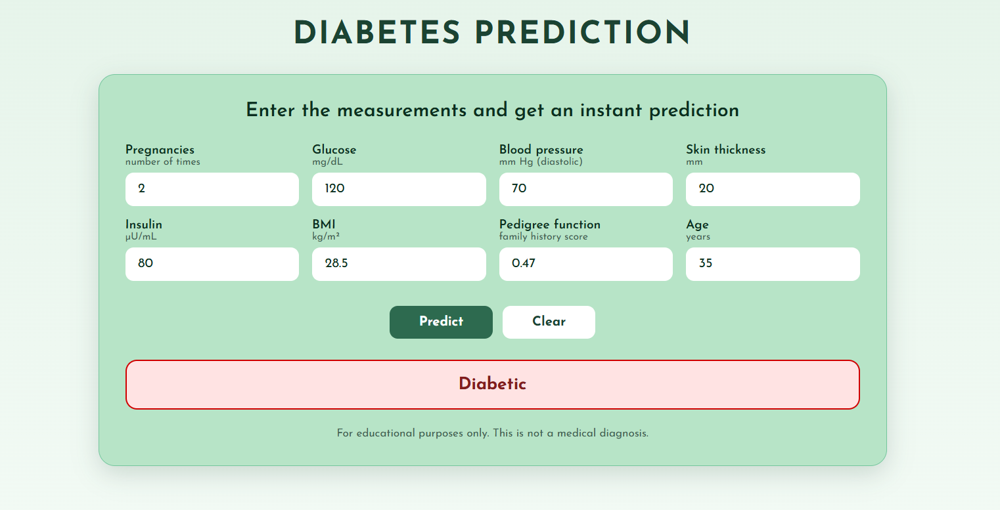

# Diabetes Prediction

A simple web app that predicts whether a person is diabetic from 8 medical measurements. The interface is built with HTML, CSS and JavaScript, and talks to a Support Vector Machine (SVM) model served by a Flask API.



> **Disclaimer:** this project is for educational purposes only. It is not a medical diagnosis tool.

## Features

- Clean, responsive form with the 8 input measurements
- Instant prediction (diabetic / not diabetic), with a confidence score when the model supports it
- Python (Flask) API that loads the trained SVM model and its scaler
- Input validation on both the browser and the server side


## Tech stack

- **Frontend:** HTML, CSS, JavaScript
- **Backend:** Python, Flask, Flask-CORS
- **Machine learning:** scikit-learn (SVM / `SVC`, `StandardScaler`), pandas, NumPy, joblib

## Dataset

Pima Indians Diabetes Dataset: 768 samples, 8 numeric features, 2 classes (0 = not diabetic, 1 = diabetic).

| Feature | Description |
|---|---|
| Pregnancies | Number of pregnancies |
| Glucose | Plasma glucose concentration (mg/dL) |
| BloodPressure | Diastolic blood pressure (mm Hg) |
| SkinThickness | Triceps skin fold thickness (mm) |
| Insulin | 2-hour serum insulin (µU/mL) |
| BMI | Body mass index (kg/m²) |
| DiabetesPedigreeFunction | Diabetes family history score |
| Age | Age in years |

The classes are imbalanced (about 65% not diabetic, 35% diabetic), so the train/test split is stratified.

## Model

The prediction is made by a **Support Vector Machine (SVM)**, using scikit-learn's `SVC` classifier.

- **Preprocessing:** features are standardized with `StandardScaler` (fitted on the training set only)
- **Split:** 75% training / 25% testing, stratified on the target (`random_state=2`)
- **Why SVM:** it works well on small tabular datasets (768 samples) and finds the boundary that best separates the two classes
- **Saved files:** `model.pkl` (the SVM) and `scaler.pkl` (the scaler)

## Model performance

| Metric | Score |
|---|---|
| Accuracy |78% |

## Project structure

```
Diabetes-Prediction/
├── index.html     # User interface
├── style.css      # Styles
├── app.py         # Flask API
├── model.pkl      # Trained SVM model
├── scaler.pkl     # Fitted StandardScaler
└── README.md
```

